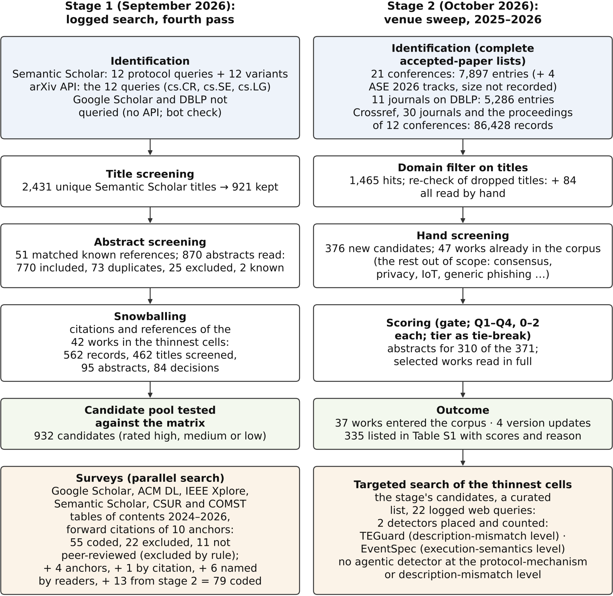

# Supplement S1 — The search

This supplement documents both stages of the search behind the survey (Section 1.1). Works are named by title and DOI (or another public identifier), never by reference number.

**Files.**
- `S1_fig_prisma.png` / `.svg` — the flow of both stages (Fig. S1).
- `S1_stage1_query_log.csv` — every query of the first stage's logged search, verbatim, with hits and screening counts.
- `S1a_stage1_candidates.csv` — Table S1a: every candidate of the first stage's pool, with how it was found and whether it entered the corpus.
- `S1_stage2_coverage.csv` — every list the second stage read, with its size and the number of titles the domain filter kept.
- `S1_screened_candidates.csv` — Table S1: every candidate of the second stage and of the targeted search, with its scores, decision and reason.
- `S1_surveys.csv` — Table S1b: every survey screened at any stage, with its coding on the three conditions of Section 3, whether and by which part of the rule of Supplementary Appendix C it is among the 32 whose taxonomies the file describes, and, for those 32, how each built its taxonomy.
- `S1_cells.csv` — Table S1d: for each cell of Table 4, the surveys among the 32 whose taxonomy has a category that maps onto it, and the nearest treatment where none does.
- `S1_survey_query_log.csv` — every query of the survey search, verbatim, with hits, titles screened and the surveys each found.
- `S1_other_sources.csv` — Table S1c: works that readers named after the searches had closed, each with its decision and reason.

*Fig. S1. The two stages of the search, with each stage's own counts; the re-screening of October 2026 (S1.6) is not drawn.*

## S1.1 Stage 1: the logged search (September 2026)

The corpus was first built in four passes (Supplementary Appendix D.1). Three of them were not logged query by query:
- the seeding of ten thematic groups from canonical works;
- backward and forward snowballing;
- the filter against the scope rule.

The fourth pass was logged. It was run on 25 September 2026, after the taxonomy had stabilized, to test the matrix rather than to seed it.

**Queries.** There were twelve protocol queries. They cover the four detector families, the three levels, and governance, business-logic and cross-chain terms. Each was run three times:
- verbatim on the Semantic Scholar bulk-search API (from 2016);
- as a variant with plural and synonym forms;
- on the arXiv API, restricted to cs.CR, cs.SE and cs.LG.

Q11 was run in two year ranges. Q5 returned 13,447 records, too many to screen, so its variant was screened in its place. The full strings, filters and counts are in `S1_stage1_query_log.csv`.

| Q | Query, as run on Semantic Scholar | Semantic Scholar hits | Variant hits | arXiv hits |
|---|---|---|---|---|
| Q1 | `"smart contract" + vulnerability + detection + (GNN ∣ "graph neural" ∣ transformer ∣ "deep learning")` | 362 | 384 | 49 |
| Q2 | `"smart contract" + (LLM ∣ "large language model" ∣ GPT) + (audit ∣ vulnerability ∣ detection)` | 327 | 337 | 130 |
| Q3 | `(agent ∣ agentic ∣ "multi-agent") + ("smart contract" ∣ DeFi) + (security ∣ exploit ∣ audit ∣ monitoring)` | 402 | 402 | 82 |
| Q4 | `DeFi + (attack ∣ exploit) + detection + (runtime ∣ "real-time" ∣ monitoring ∣ transaction)` | 78 | 110 | 36 |
| Q5 | `("price manipulation" ∣ "flash loan" ∣ "oracle manipulation" ∣ MEV ∣ sandwich) + detection` | 13,447 (too broad; replaced by its variant) | 103 | 50 |
| Q6 | `(Ponzi ∣ "pump and dump" ∣ "rug pull" ∣ honeypot ∣ "scam token") + detection + (Ethereum ∣ BSC ∣ Solana)` | 100 | 161 | 22 |
| Q7 | `("governance attack" ∣ DAO ∣ "malicious proposal" ∣ "voting power") + (detection ∣ monitoring)` | 441 | 102 | 221 |
| Q8 | `("business logic" ∣ "logic vulnerability" ∣ "logic bug" ∣ intent ∣ invariant) + "smart contract" + (detection ∣ inference ∣ mining)` | 106 | 141 | 59 |
| Q9 | `("runtime verification" ∣ invariant ∣ specification ∣ formal) + DeFi + protocol` | 66 | 66 | 39 |
| Q10 | `blockchain + transaction + "anomaly detection" + (graph ∣ temporal ∣ sequence)` | 100 | 187 | 9 |
| Q11 | `"smart contract" + (fuzzing ∣ "symbolic execution" ∣ "static analysis") + tool` | 56 (2016-2020) + 290 (2021-) | 438 | 85 |
| Q12 | `"cross-chain bridge" + (attack ∣ exploit) + detection` | 16 | 61 | 7 |

**Screening.**
- Title screening. The Semantic Scholar results came to 2,431 unique titles once duplicate paper ids were removed. 921 titles were kept.
- The arXiv runs. The 789 arXiv hits were screened on their titles and abstracts separately; `S1_stage1_query_log.csv` gives, for each query, how many entered the candidate pool where that was recorded.
- Abstract screening. Of the kept titles, 51 were works already known and were set aside. The other 870 abstracts were read: 770 were included, 73 were duplicates, 25 were excluded, and 2 were further known works.
- Snowballing. The citations and references of the 42 works then placed in the thinnest cells came to 562 records. Of these, 462 titles were screened, 95 abstracts were read, and 84 decisions were made.
- Result. The pool held 932 candidates, each rated high, medium or low. Each candidate was tested against the matrix as it then stood.
- Table S1a (`S1a_stage1_candidates.csv`) lists 930 of these candidates with their identifiers, how each was found and whether it entered the corpus: 110 did, 96 of them matched against the bibliography by identifier or title and 14 entered in October 2026 (S1.6); one more, a preprint, was excluded by the rule of S1.5. Two records of the pool named no identifiable work and are omitted. The first stage recorded no per-candidate reason for leaving a work out; the re-screening of October 2026 recorded one for two candidates it left out (S1.6).

**Not queried.**
- Google Scholar: it has no API, and scraping it would breach its terms.
- DBLP: a bot check blocked it, and the check was not bypassed.
- IEEE Xplore and the ACM Digital Library: they were reached only through the Semantic Scholar index and DOI look-ups.
- OpenAlex: it was used only to verify metadata.

**Surveys.** A parallel search looked for prior surveys. It used:
- the native interfaces of Google Scholar, the ACM Digital Library and IEEE Xplore;
- the Semantic Scholar API;
- the 2024–2026 tables of contents of ACM Computing Surveys and IEEE Communications Surveys & Tutorials;
- the forward citations of ten anchor works.

Every query is in `S1_survey_query_log.csv`. Every survey the search found that offers a taxonomy of attacks or of defenses in this domain was coded on the three conditions of Section 3:
- does it name governance or description-mismatch attacks as a category of its attack taxonomy (yes, partial, no);
- does it name LLM-based or agentic detectors as a class of its detector taxonomy;
- does it place the two in one table.

The search coded 55 peer-reviewed surveys, two of them after a reader questioned their exclusion as pre-2024, and excluded 22 further records, each with a reason; 11 surveys it found were not peer-reviewed at the time of writing and were excluded by the rule of S1.5. The same coding was applied to four earlier anchor surveys, to one found by citation checking, to nine that readers named, and to the 13 surveys the second stage found that the search had not coded.

**Table S1b** (`S1_surveys.csv`) lists all 112 records:
- 82 surveys coded: 63 on full text, 6 on part of it, and 13 on the abstract alone, where nothing more could be obtained;
- 22 exclusion records of the search (six of them bundle works screened together; each work is named with its venue, identifier and peer-review status);
- 8 surveys not coded, with the reason; one of them, a preprint that a reader named, is excluded by the rule of S1.5.

**The 32 surveys whose taxonomies S1 describes.** The column `selected` records the rule of Supplementary Appendix C by which 32 of the coded surveys are selected:
- `tradition`: the anchors and representatives of the traditions Section 3 discusses;
- `rule`: every other peer-reviewed survey whose taxonomy names governance or description-mismatch attacks, in full or in part, or agentic detectors as a class.

For these 32, four columns give how each survey built its taxonomy, as its own text states it: `anomaly_categories` and `detector_categories`, its axis and first-level categories (second levels and details that are not categories are left out, except where a coding rests on them); `corpus_method`, its stated procedure for selecting the works it classifies, shortened to the procedure and its flow; and `works_classified`, their number as the survey counts them. n.s. = not stated in the source. The marks ✓, ◐ and ✗ of Table 2 and of Supplementary Appendix C correspond to yes, partial and no in the coding columns.

**The 32 against the cells of Table 4.** `S1_cells.csv` (Table S1d) gives, for each of the twelve cells, the surveys among the 32 whose taxonomy contains a category that maps onto it (`surveys_with_a_matching_category`) and the nearest treatment where none does, or where a survey's nearest rows are not equivalents (`nearest_treatment`). Each survey is named with its record in Table S1b. The marks ●, ◐ and ○ reproduce, verbatim, the coverage marks of the one survey with a comparable cross-tabulation, Li et al. (A01): "●= strong coverage, ◐= partial or assumption-dependent coverage, and ○= absent or negligible coverage" (their Table 5). The caption of their table scopes the LLM-assisted column to detection evidence only. The marks are the authors' evidence-weighted judgments over their corpus, not counts, and are quoted as such. Li et al.'s rows are layers and gap boundaries, not anomaly levels, so their "protocol layer" and "dependency/logic" boundary are their nearest rows to ours, not equivalents. Table S1d is the evidence for what Supplement S5 says, cell by cell, of other work.

**The claim on the whole record.** No coded survey names a governance category and an agentic class at once. The surveys with an agentic class are Xia et al., Okundia et al. and Ince et al. None of them names governance attacks as a category; Xia et al. treat governance as a direction for agents and a threat to them (partial). Of the 13 surveys coded on the abstract alone, 12 could not be determined on these conditions, and the abstract of the thirteenth rules out all three.

## S1.2 Stage 2: the venue sweep (October 2026)

**Lists read.** The second stage read complete lists rather than keyword results:
- **21 conferences.** For 2025 and 2026, the full accepted-paper list of each, with workshops and companion tracks where the proceedings include them: 7,897 entries where a list states its size. Four ASE 2026 tracks (NIER, journal-first, industry and tools) were read in full, but their size was not recorded. The lists were read from DBLP where it has them, and otherwise from the official program or the researchr accepted-papers table.
- **11 journals on DBLP.** Their 2025–2026 volumes: 5,286 entries.
- **30 journals and the proceedings of 12 conferences through Crossref:** 86,428 records. Crossref was used after DBLP put a bot check in front of its site, which was not circumvented. Every work with a 2025–2026 issue date was read, by journal ISSN or by exact proceedings title. Crossref also lists online-first articles, so the DBLP journals were read there a second time; that second read is one row of `S1_stage2_coverage.csv`, with its per-journal counts not recorded.

The conference lists are: S&P 2025; S&P 2026; S&P Workshops 2025/26; CCS 2025; CCS 2026; USENIX Sec 2025; USENIX Sec 2026; NDSS 2025; NDSS 2026; EuroS&P 2025/26; EuroS&P Workshops 2025/26; AsiaCCS 2025/26; RAID 2025; ACSAC 2025 (+W); DSN 2025/26 (+W, +S); AFT 2025; FC 2025 (+W1,W2); FC 2026; ESORICS 2025 (+W1-3); ICSE 2025 (+Companion, NIER); ICSE 2026; ICSE-NIER 2026; FSE 2025 + ISSTA 2025; FSE 2026; FSE Companion 2025/26; ISSTA Companion 2025; ISSTA 2026; ASE 2025 (+W); ASE 2026; ICSME 2025; ISSRE 2025 (+W); SANER 2025/26 (+Companion); MSR 2025/26; ICST 2025/26. In `S1_stage2_coverage.csv` the rows follow the groups in which the lists were read: a conference may share a row with its workshops or companion volume, and several Crossref journals share a row.

**Not covered.**
- ICSE 2027, which had no list yet.
- ESORICS, RAID and ACSAC 2026.
- AFT 2026.
- ICSME and ISSRE 2026.
- CoDecFin 2026.

**Filter and screening.**
- The domain filter. One regular expression ran over titles (smart contract, DeFi, blockchain, Ethereum, Solidity, EVM, token, Web3, DApp, DAO, flash loan, MEV, front-running, rug pull, bridge, cross-chain and related terms). For four journals (TDSC, TIFS, BCRA, TOPS) a security term was also required. The filter kept 1,465 titles.
- The re-check. All titles the noise filter had dropped were listed again, and every one carrying a strong detection term was kept. This caught 84 more.
- Hand screening. Every kept title was read by hand. Consensus, cryptography, privacy, payment-channel, IoT, generic phishing and LLM-token titles were dropped as out of scope. 376 titles were new candidates. 47 were works already in the corpus.

**Scoring.** Each candidate was judged against the role it could fill: an exemplar of a cell, an occupant of a thin cell, the support for a claim, a related survey, or coverage of a chain outside the EVM.
- **Gate.** A candidate had to be in scope, peer-reviewed and archival.
- **Four criteria**, each scored 0–2:
  - Q1, method;
  - Q2, evaluation on real data;
  - Q3, comparison with baselines;
  - Q4, released code or data.
- **Tie-breaker:** venue tier (T1–T3).
- **Replacement rule.** A candidate replaced an incumbent when it scored at least two points higher, or the same and one tier higher. Anchor works were never replaced.

The sweep produced 371 candidates; abstracts were obtained for 310 of them, and those were scored. The re-check of dropped titles added five more, none of them selected. The works selected were read in full where the full text could be obtained. In October 2026 the re-screening scored 39 of the 57 candidates recorded without an abstract, 37 on abstracts found then and two read in full (S1.6).

**Outcome.**
- 37 works entered the corpus, and the re-screening of October 2026 selected four more of the stage's candidates (S1.6).
- 4 entries were updated to their published or extended versions.
- The other 332 candidates are listed in Table S1.

Years in Table S1b are those of the version its venue column names.

**Table S1** (`S1_screened_candidates.csv`) has these columns:
- title, venue, year;
- class:
  - detector or auditor;
  - exploit generation;
  - evaluation, benchmark, dataset or study;
  - mitigation, repair or prevention;
  - borderline scope;
  - survey;
- tier, Q1–Q4 and their sum Q (empty where no abstract could be obtained);
- the DOI or link;
- how the work was found (venue sweep, filter re-check, or targeted search);
- the decision, and the reason for it.

A selected work's reason gives the name it carries in this survey.

## S1.3 The targeted search of the thinnest cells (9 October 2026)

**Cells.** The search covered three cells:
- the description-mismatch level;
- Protocol-mechanism × Agentic;
- Description-mismatch × Agentic.

It looked for peer-reviewed works from 2025–2026 that were not already in the corpus.

**Sources.**
1. **The second stage's candidates.** A title expression picked out every candidate that mentions comments, documentation, whitepapers, NatSpec, specifications, intent, (in)consistency, compliance or conformance, ERC/EIP, standards, proposals, governance, DAOs or front-ends. The ten that could belong to a thin cell were read at abstract level.
2. **A curated list:** github.com/hzysvilla/Academic_Smart_Contract_Papers, at its commit of 10 September 2026. Its 2025–2026 sections were searched with the same terms and gave 16 hits.
3. **22 logged web queries**, listed below.

**Result.**
- **Two peer-reviewed detectors, both placed and counted under the rules of Section 4.4:**
  - TEGuard (CCSB 2025, doi:10.1109/CCSB66722.2025.11154237), at the description-mismatch level. It checks event completeness and consistency in token contracts against the token standard. It is a five-page paper with a preliminary evaluation, counted with ◊ like every short paper.
  - EventSpec (ISSTA 2026, doi:10.1145/3832273), at the execution-semantics level, with a secondary row at the description-mismatch level: the event specifications it checks are inferred from a corpus of contracts.
- **No agentic detector at the protocol-mechanism or description-mismatch level.** The agentic auditors found are preprints, and all of them evaluate execution-semantics findings.

**Re-screening.** The re-screening of October 2026 (S1.6) read again the first stage's candidates, which this search had not re-read, and entered four detectors in its cells: TokenCat, Liu et al. (SpaCCS 2024) and SmartGuard at the description-mismatch level, and FOMOCheck at Protocol-mechanism × Agentic. TokenCat (ICC 2022) and Liu et al. (SpaCCS 2024) are older than the years this search covered. SmartGuard (SN Comput. Sci. 2025, doi:10.1007/s42979-025-04298-2), a description-mismatch detector from 2025, was a first-stage candidate that this search's queries had not retrieved; the re-screening entered it. FOMOCheck, also from 2025, was a first-stage candidate that this search did not reach either. Neither search found a detector at Description-mismatch × Agentic.

**Queries.**
1. smart contract code comment inconsistency detection 2025 2026
2. whitepaper smart contract consistency detection LLM token
3. DAO governance proposal description code mismatch detection
4. ERC standard compliance violation detection smart contracts LLM 2025
5. DApp front-end smart contract inconsistency detection UI description
6. smart contract documentation NatSpec code inconsistency LLM detection
7. multi-agent LLM framework DeFi attack detection price manipulation 2026
8. LLM agent tool calling blockchain transaction anomaly detection DeFi exploit monitoring
9. EventSpec event-semantic issues blockchain ISSTA 2026
10. LLM agents DAO governance proposal risk analysis malicious proposal detection
11. LLM generate formal properties from smart contract documentation natural language specification verification 2025
12. agentic smart contract auditing framework DeFi economic vulnerabilities peer-reviewed 2026 ICSE FSE ASE
13. LLM rug pull detection agent token contract on-chain data 2025 2026 journal
14. token contract behavior inconsistent with project claims detection LLM tokenomics whitepaper
15. "EventSpec" smart contract events
16. malicious DAO governance proposal detection tool 2025 conference paper
17. ERC-721 ERC-1155 ERC-4626 standard non-compliance detection smart contracts 2025 2026
18. Solidity code comment inconsistency detection pre-trained model 2025 journal
19. DApp frontend backend inconsistency detection 2026 smart contract user interface
20. NeurIPS 2025 OR ICLR 2026 OR ICML 2025 LLM agent smart contract DeFi security detection paper
21. ACL EMNLP 2025 smart contract LLM agent auditing vulnerability detection findings
22. IEEE TIFS TDSC 2026 LLM agent DeFi attack detection on-chain transactions tool use

## S1.4 Works named by readers

Readers of drafts named further works after the searches had closed. **Table S1c** (`S1_other_sources.csv`) lists the 45 of them that are not surveys, each with its decision and reason under the rules of Table S1:
- 2 are placed and counted: POMABuster and ASCD;
- 5 are placed and shown in Supplementary Table 7, not counted: W. Ma et al. and FRBScan as studies, DocCon as adjacent, STING as offensive and SC-Bench as a benchmark;
- 1 is selected as support for a claim: Fake Memories;
- 3 are already in the corpus;
- 34 are not selected. Of these, 16 are first-stage candidates of Table S1a, and their rows give the reason that table does not record.

The ten surveys named in this way are in Table S1b (records E10 to E19): nine are coded, and the tenth, a preprint, is excluded by the rule of S1.5. 22 of the rows of Table S1c and records E16 to E19 were added in the re-screening of October 2026 (S1.6).

## S1.5 The peer-review rule

Works not peer-reviewed at the time of writing were read during the search and are excluded by rule (Supplementary Appendix D.5): a paper accepted at a peer-reviewed venue counts as peer-reviewed, and a paper presented at a workshop without archival proceedings does not. Standards, specifications, repositories, and incident records are cited for what they state. The search records above keep every query and every count, including the works this rule excludes. Records that this rule excludes are listed by title in these logs as part of the screening record; they are not cited, and no placement or claim rests on them.

## S1.6 The re-screening (October 2026)

In October 2026, after the searches had closed, four sets of records were read again.

**What was re-read.**
- **The agentic column.** The candidates of both stages whose titles name agents or language models were read again, so that every peer-reviewed agentic detector among them would be coded: the targeted search (S1.3) had covered two cells of the column and had not re-read the first stage's candidates.
- **The description-mismatch level.** The candidates of both stages that could belong to the level were read again, because the targeted search had covered 2025–2026 and had not re-read the first stage's candidates.
- **The candidates recorded without an abstract.** The 57 candidates of Table S1 that had been decided on their titles alone were looked up again.
- **The works readers named.** The works and surveys that readers named last, 21 rows of Table S1c and records E16 to E19 of Table S1b (S1.4), were coded under the rules of Table S1 and of Section 3.

**What entered.** The reference list gained 22 works: the 21 that the re-screening and the readers entered, and PrimeVul, cited for a claim (below). The 18 of them placed in the matrix (Table 4 and Supplementary Table 7) rest on their full texts (Supplement S2, column `access`).
- **14 placed and counted** under the rules of Section 4.4, three of them short papers counted with ◊ (FOMOCheck, UniFuzz and TokenCat):
  - seven agentic detectors, all first-stage candidates: FOMOCheck (CHIuXiD 2025, doi:10.1109/CHIuXiD68326.2025.11323569) at the protocol-mechanism level, and at the execution-semantics level VulnPatch (BCCA 2025, doi:10.1109/BCCA66705.2025.11229600), SEMA (Electronics 2026, doi:10.3390/electronics15102187), AutoSCAR (DAPPS 2026, doi:10.1109/DAPPS69803.2026.00023), VulnDetective (TPS-ISA 2025, doi:10.1109/TPS-ISA67132.2025.00043), EG-MAP (SSE 2026, doi:10.1109/SSE72781.2026.00018) and UniFuzz (VCRIS 2025, doi:10.1109/VCRIS68011.2025.11250519); none is at the description-mismatch level;
  - three detectors at the description-mismatch level, all first-stage candidates: TokenCat (ICC 2022, doi:10.1109/ICC45855.2022.9839252), Liu et al. (SpaCCS 2024, doi:10.1109/SpaCCS63173.2024.00013) and SmartGuard (SN Comput. Sci. 2025, doi:10.1007/s42979-025-04298-2);
  - two second-stage candidates recorded without an abstract, each two points above the scored incumbent of its role and entered beside it: RcAudit (ASE 2026, doi:10.1145/3832783.3837471), at Protocol-mechanism × LLM, beside PromFuzz, and DeepDesc (EMSE 2026, doi:10.1007/s10664-025-10770-7), also a first-stage candidate, at Execution-semantics × LLM, beside CodeXplain;
  - two works that readers named: POMABuster (IEEE S&P 2024, doi:10.1109/SP54263.2024.00257), at Protocol-mechanism × Rule-based, a first-stage candidate, and ASCD (ACM TOSEM 2026, doi:10.1145/3744709), at Execution-semantics × ML, a second-stage candidate that the sweep had scored and not selected.
- **4 placed and shown in Supplementary Table 7, not counted:**
  - FaultSeeker (ASE 2025, doi:10.1109/ASE63991.2025.00017), post-incident, an agentic first-stage candidate;
  - STING (USENIX Security 2023, pp. 1757–1774), offensive, a first-stage candidate that a reader named;
  - SC-Bench (LLM4Code 2025, doi:10.1109/LLM4Code66737.2025.00012), a benchmark that a reader named;
  - FRBScan (Chin. J. Electron. 2026, doi:10.23919/cje.2025.00.156), a study that a reader named and that the search records do not hold.
- **4 cited as support for a claim:**
  - FORGE (ICSE 2026, doi:10.1145/3744916.3764529) and Liu et al. (EMSE 2025, doi:10.1007/s10664-025-10685-3), second-stage candidates recorded without an abstract, scored in the re-screening and selected; both are cited in Supplementary Appendix F only;
  - Fake Memories (FC 2026, arXiv:2503.16248), a second-stage candidate recorded without an abstract, scored in the re-screening and not selected for a role of Table S1; a reader named it later, and it is cited in Section 7 (P3) as support for a claim (Table S1c);
  - PrimeVul (ICSE 2025, doi:10.1109/ICSE55347.2025.00038), a study of vulnerability detection with code language models outside this domain, cited in Section 7 (P2) for the paired, chronological evaluation of code-vulnerability detectors; it is not a record of the search and has no row in these tables.
- **3 surveys** that readers named, coded in Table S1b and not among the 32, so that, like the other coded surveys outside the 32, they are not in the reference list: Jain and Tripathi (Comput. Electr. Eng., E16, doi:10.1016/j.compeleceng.2025.110895) and Ding et al. (Blockchain Res. Appl., E17, doi:10.1016/j.bcra.2025.100402), each on part of its text, and Kareem and Shakir (Informatica, E18, doi:10.31449/inf.v49i33.7990), on its full text. In the text read, none of the three names governance attacks as a category or agentic detectors as a class. A fourth survey that a reader named, Large language models for blockchain security: A systematic literature review (arXiv:2403.14280, E19), is a preprint, excluded by the rule of S1.5.

**Read and not selected.**
- **Agentic candidates.** Two first-stage candidates were left out, each with its reason in Table S1a: Robust Detection and Analysis of Smart Contract Vulnerabilities with Large Language Model Agents (J. Inf. Secur. 2025, doi:10.4236/jis.2025.161011), whose venue is on Beall's list and whose ground truth is not independent; and Multi-Agent Auditing for Smart Contracts (ISCSIC 2025, doi:10.1109/ISCSIC67494.2025.11352002), the conference version of SEMA, which entered in its place.
- **Candidates recorded without an abstract.** Of the 57, 39 carry scores in Table S1, 37 on abstracts found in October and two read in full. Four of them, RcAudit, DeepDesc, FORGE and Liu et al. (EMSE 2025), were selected (above); the other 35 were not, each with its reason in Table S1, among them:
  - Revealing Honeypots in High-Frequency Interactions on Decentralized Applications (IEEE TIFS 2026, doi:10.1109/TIFS.2026.3687759), read in full, Q 6: rules over the transactions of a block find bait-and-replace attacks on sandwich bots, at Protocol-mechanism × Rule-based, a cell with 32 counted systems; it has no replacement margin over the scored incumbents of its role, POMABuster (Q 8) and Gold Digger (Q 5), and no thin cell or claim needs it;
  - BELMA (IEEE TDSC 2026, doi:10.1109/tdsc.2026.3725656), read in full, Q 7: at Execution-semantics × LLM, it was considered as an extra exemplar and not added, its cell being already represented; it has no replacement margin over HKT-SmartAudit or SCALM (Q 6), and its slices for chains outside the EVM carry no per-chain counts;
  - Belobog (ISSTA 2026, doi:10.1145/3832169), Q 4: coverage of a chain outside the EVM is one role, and it has no replacement margin over the role's incumbents, Soleker (Q 6) and TONScanner (Q 5);
  - Fake Memories, Q 5: an attack on LLM agents that hold assets, not a detector of DeFi attacks (it entered as support for a claim, above);
  - LLMs as verification oracles for Solidity (FC 2026), Q 7: evidence on language-model verdicts against formal verifiers, which no claim of the survey rests on and no thin cell needs.
- **Still without an abstract.** The other 18 still had no obtainable abstract when they were checked again on 29 October 2026 (15 published by Elsevier, two in IEEE early access, one by Springer); they are decided on their titles, as before.
- **Out of scope.** LineBreaker (ASE 2025, doi:10.1109/ASE63991.2025.00079), which the sweep had scored, finds token-inconsistency bugs in Python and C programs, not in smart contracts (Supplementary Appendix B.3).
- **Works readers named.** Of the 22 rows added to Table S1c, 16 are not selected, each with its reason (S1.4).

**Where the re-screening is recorded.**
- **Table S1a**, column `entered the corpus`: `yes` for the 14 first-stage candidates that entered (the seven agentic detectors, FaultSeeker, the three description-mismatch detectors, POMABuster, STING and DeepDesc), and a reason after `no:` for the two agentic candidates left out. The records of BlockLens (venue: ISC 2025, LNCS 16186), BlockScan (year: 2025) and Belobog (venue, year and identifier; its venue also in Table S1) give the details checked in the re-screening.
- **Table S1**: three rows for the description-mismatch detectors, whose `found by` reads `re-screening of the first-stage candidates for the description-mismatch level` and which carry no scores; Q1–Q4, Q, `decision` and `reason` for the 39 candidates scored, with a DOI in `doi or link` for three of them; the `reason` of LineBreaker; and a pointer to Table S1c in the `reason` of three candidates that readers named later (ASCD, Fake Memories and Synesthete, IEEE TIFS 2026, doi:10.1109/TIFS.2026.3723161).
- **Table S1c**: 22 of its 45 rows, Belobog's among them. The `decision` of W. Ma et al. gives its cell, Description-mismatch × Rule-based; the decisions of the five entries shown and not counted point to Supplementary Table 7; and the reasons that quote a cell's count give the count Table 4 prints.
- **Table S1b**: records E16 to E19, 112 in all; record B13 is named Ding et al. (TNSE), to tell it from E17.
- **Supplements S2 and S4**: the 18 placements are rows of the placement sheet, and the 11 of them in the LLM and agentic columns are rows of the adaptive-acquisition record.
